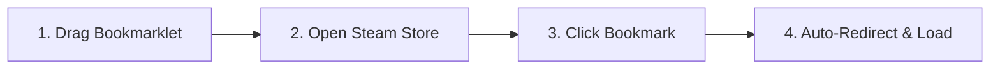

<div align="center">

  

  # 🎮 Steam Family Games

  <p align="center">
    <strong>A sleek, high-performance, SteamDB-inspired web dashboard to view, search, and filter games across your Steam Family Group.</strong>
  </p>

  <p align="center">
    <a href="https://solvedegiggi.github.io/steam-family-games/"></a>
    <a href="https://github.com/Solvedegiggi/steam-family-games/blob/main/README.md"></a>
    
    
    
    
  </p>

  <p align="center">
    <a href="https://solvedegiggi.github.io/steam-family-games/"><b>🚀 Launch Live Application</b></a> •
    <a href="#-features"><b>Explore Features</b></a> •
    <a href="#-how-to-sync-your-family-library"><b>How to Sync</b></a> •
    <a href="#-local-development"><b>Quick Start</b></a> •
    <a href="#-privacy--security"><b>Privacy & Security</b></a>
  </p>

</div>

---

## 📖 Overview

Steam's **Family Sharing** feature lets up to six members share their game libraries. However, browsing a shared catalog across multiple members in the official Steam client can make it hard to answer simple questions:
- *Which multiplayer or co-op games do at least 3 of us own for tonight's session?*
- *Who owns which copy?*
- *Which games support crossplay or local split-screen?*
- *Which games are excluded from family sharing?*

**Steam Family Games** solves this with a lightweight, dark-themed dashboard inspired by [SteamDB](https://steamdb.info/). It runs **100% statically on GitHub Pages** with zero backends, zero external proxies, and zero authentication credentials required.

---

## ✨ Features

### 🎯 SteamDB-Inspired Dashboard
- **Dark High-Contrast Theme:** Clean, legible layout matching modern gaming databases.
- **Game Capsules & Quick Links:** Instant game artwork with direct shortcuts to **Steam Store** and **SteamDB** pages.
- **Dynamic Status Bar:** Displays the family group name, active game count, and member profile bar.

### 🎛️ Advanced 4-State Tri-State Filter Matrix
Filter your library with granular control using our interactive 4-state buttons:

| State | Icon | Filter Behavior |
| :---: | :---: | :--- |
| **Neutral** | `—` | **Default / Ignore:** Does not restrict games by this criterion. |
| **Include** | `✓` | **Require Tag:** Shows only games that possess this mode or are owned by this member. |
| **Exclude** | `✕` | **Block Tag:** Hides all games that match this mode or are owned by this member. |
| **Exclusive** | `✓✓` | **Strict Match:** Shows only games that have *strictly* this tag and no conflicting modes. |

Supported filter groups:
- **Player Modes:** *Single-player*, *Multiplayer*, *Co-op*, *Local MP*, *PvP*, and *Crossplay*.
- **Family Owners:** Filter dynamically by specific family members.
- **Game Availability:** Filter *Shareable*, *Not Shareable* (family-locked games), and *Free to Play*.

### 🔢 Copies in Family Selector
Quickly spot games ready for multiplayer groups of any size:
- Filter by minimum copies owned: **Any (1+)**, **2+ Copies**, **3+ Copies**, **4+ Copies**, **5+ Copies**, or **6 Copies**.

### 👥 Family Member Customization & Tracking
- **Owner Profile Badges:** Displays member avatars on each game row with total copy counts.
- **Custom Nicknames:** Click any member's avatar in the top status bar to assign a custom nickname (saved in browser `localStorage`).
- **Active Profile Selection:** Right-click an avatar to designate your primary active user profile.
- **Profile Links:** Click an avatar to open that member's public Steam Community profile.

### 🔍 Instant Search & Multi-Column Sorting
- Real-time debounced search by game title.
- Sortable columns:
  - **Game Name:** Ascending (`A → Z`) or Descending (`Z → A`).
  - **Copies Count:** Highest to lowest (`6 → 1`) or lowest to highest (`1 → 6`).

### ⚡ 60 FPS Infinite Scrolling
- Virtualized lazy-rendering powered by `IntersectionObserver`.
- Effortlessly handles huge shared libraries with **2,000+ titles** at a smooth 60 FPS without DOM slowdown or memory bloat.

### 🌐 Internationalization (i18n)
- Native bilingual support for **English** (`EN`) and **Italian** (`IT`).
- Flag dropdown switcher with automatic browser language detection.

---

## 🕹️ How to Sync Your Family Library

You can load your family catalog using three convenient methods:

### Option 1: 1-Click Bookmarklet *(Recommended)*

No tokens, no API keys, and no manual downloads required.



1. Visit the live site: **[solvedegiggi.github.io/steam-family-games](https://solvedegiggi.github.io/steam-family-games/)**
2. Click **Sync / Login** in the top navigation bar.
3. Drag the **🔄 Sync Steam Family Games** pill button to your browser's Bookmarks bar.
4. Open **[store.steampowered.com](https://store.steampowered.com)** in your browser (make sure you are logged in).
5. Click your **Sync Steam Family Games** bookmark.
6. The bookmarklet securely reads your active Steam session, pulls the family group data and member profiles, and redirects you right back to the app with your entire library loaded!

<details>
<summary><b>Option 2: Steam Console Snippet (Alternative)</b></summary>

If you cannot use a bookmarks bar (e.g. mobile or restricted browsers):

1. Navigate to **[store.steampowered.com](https://store.steampowered.com)** while logged in.
2. Open developer tools by pressing <kbd>F12</kbd> (or right-click anywhere &rarr; *Inspect*).
3. Switch to the **Console** tab.
4. Copy the script from the **Steam Console Snippet** tab inside the app's sync modal.
5. Paste it into the console and press <kbd>Enter</kbd>.
6. You will be redirected back with your family games loaded.

</details>

<details>
<summary><b>Option 3: JSON File Drop & Backup Export (Offline / Manual)</b></summary>

1. In the sync modal, click **Download Backup JSON** to save a local snapshot of your library (`family_games.json`).
2. To restore or load a library on another computer, open the **Drop JSON File** tab and drag & drop your `family_games.json` file (or paste raw JSON).

</details>

> [!TIP]
> **Want to test it out first?** Click **Preview Demo Library** on the home page to immediately explore the interface with a sample 6-member family dataset.

---

## 🔒 Privacy & Security

| Security Guarantee | How It Works |
| :--- | :--- |
| **100% Client-Side** | All computation, search filtering, and DOM updates execute directly inside your browser. |
| **Zero External Proxies** | No requests are sent to third-party databases, tracking servers, or telemetry endpoints. |
| **No Password or Token Storage** | We never ask for your Steam username, password, Guard code, or persistent API keys. |
| **Local Storage Persistence** | Library cache and custom nicknames live strictly in your browser's private `localStorage`. |
| **One-Click Wipe** | Click **Clear saved data** inside the sync modal at any time to instantly purge all stored records. |
| **Git-Ignored Backups** | Exported backup files (`family_games.json`, `*backup*.json`) are included in `.gitignore` to prevent accidental commits of personal library data. |

---

## 💻 Local Development

Because **Steam Family Games** is a 100% client-side web application with zero dependencies and no build steps, running it locally is instant:

```bash
# 1. Clone the repository
git clone https://github.com/Solvedegiggi/steam-family-games.git

# 2. Enter project directory
cd steam-family-games

# 3. Start any static local web server
# Option A: Using Python built-in module
python -m http.server 8080

# Option B: Using Node.js
npx serve

# Option C: Using VS Code extension "Live Server" or any web server of your choice
```

Then open `http://localhost:8080` (or the port provided by your server) in your browser.

---

## 📁 Project Structure

```text
steam-family-games/
├── index.html                  # Main application markup & dashboard layout
├── css/
│   └── style.css               # SteamDB-inspired dark mode styling & responsive layout
├── js/
│   ├── app.js                  # Table rendering, filtering, sorting, infinite scroll & state
│   ├── bookmarklet.js          # Steam session sync bookmarklet generator
│   ├── categories-service.js   # Precompiled metadata service & local caching
│   ├── demo-data.js            # Sample family dataset for offline exploration
│   └── i18n.js                 # Multilingual translation engine (EN / IT)
├── lang/
│   ├── en.json                 # English translation dictionary
│   └── it.json                 # Italian translation dictionary
├── assets/
│   ├── steam_logo.svg          # Steam brand icon
│   ├── steamdb_logo.svg        # SteamDB external link icon
│   ├── sync logo.svg           # Bookmarklet & sync icon
│   └── flags/
│       ├── en.svg              # English language flag
│       └── it.svg              # Italian language flag
├── data/
│   └── categories.json         # Precompiled mapping of Steam AppIDs to multiplayer categories
└── README.md                   # Project documentation
```

---

## 🧰 Tech Stack

- **Core:** Vanilla JavaScript (ES6+), Semantic HTML5, Modern CSS3 (Variables, Flexbox, Grid)
- **Performance:** `IntersectionObserver` virtualization for 60 FPS infinite scrolling
- **Localization:** Custom zero-dependency i18n dictionary system
- **Storage:** Browser `localStorage` for private persistence
- **Hosting:** GitHub Pages (Static hosting, zero build steps, zero external dependencies)

---

## 🤝 Contributing

Contributions, bug reports, and feature suggestions are warmly welcomed!

1. Fork the Project (`https://github.com/Solvedegiggi/steam-family-games/fork`)
2. Create your Feature Branch (`git checkout -b feature/AmazingFeature`)
3. Commit your Changes (`git commit -m 'Add some AmazingFeature'`)
4. Push to the Branch (`git push origin feature/AmazingFeature`)
5. Open a Pull Request

---

## 📜 Disclaimer & License

- Distributed under the **MIT License**.
- **Disclaimer:** This project is an independent community tool and is not affiliated with, authorized, maintained, sponsored, or endorsed by **Valve Corporation**, **Steam**, or **SteamDB**. Steam and the Steam logo are trademarks or registered trademarks of Valve Corporation. SteamDB is a registered trademark of SteamDB.
